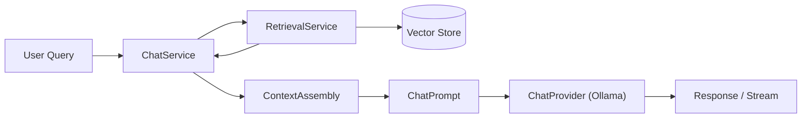
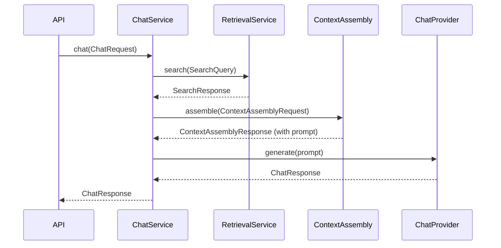

# Chat Subsystem

> **Status:** Complete
> **Sprint Introduced:** Sprint 6
> **Last Updated:** Sprint 12.1
> **Reading Time:** 4 minutes
> **Audience:** Backend contributors
> **Prerequisites:** [Retrieval](retrieval.md)
> **Related ADRs:** ADR-0012, ADR-0017
> **Related APIs:** `POST /chat`, `GET /chat/stream`
> **Next Reading:** [Editing](editing.md)

---

## Executive Summary

The Chat subsystem provides repository-aware conversational AI. It retrieves semantically relevant content from the indexed repository, assembles it into a prompt with retrieved context, and generates responses via a local LLM. Chat never indexes — it only retrieves.

---

## Responsibilities

- Query-based semantic retrieval (via `RetrievalService`)
- Context assembly (retrieved content → structured prompt)
- LLM interaction (text generation and streaming via `ChatProvider`)
- Conversation state management

---

## Ownership Boundaries

| Owned | Not Owned |
|-------|-----------|
| Conversational AI | Repository indexing |
| Context assembly integration | Embedding generation |
| Prompt construction | Vector storage |
| LLM interaction | Repository scanning |
| Streaming responses | Filesystem writes |
| — | Vector search (delegated to Retrieval) |

---

## Architecture



---

## Lifecycle: Chat Request



---

## Key Files

### ChatService

- **File:** `app/chat/service.py`
- **Dependencies:** `RetrievalService`, `ContextAssembly`, `ChatProvider`
- **Methods:**
  - `chat(request: ChatRequest) -> ChatResponse` — retrieve, assemble, generate
  - `stream(request: ChatRequest) -> Iterator[ChatChunk]` — streaming variant

### ContextAssembly (Interface)

- **File:** `app/context_assembly/providers.py`
- **Method:** `assemble(request: ContextAssemblyRequest) -> ContextAssemblyResponse`

### DefaultContextAssembly

- **File:** `app/context_assembly/service.py`
- Builds a `ChatPrompt` with system instruction + retrieved context + user query

### ChatPrompt

- **File:** `app/chat/models.py`
- Contains a list of `ChatMessage` objects (role + content)

### ChatProvider (Interface)

- **File:** `app/chat/providers.py`
- **Methods:** `generate(prompt) -> ChatResponse`, `stream(prompt) -> Iterator[ChatChunk]`

### OllamaChatProvider

- **File:** `app/chat/ollama_provider.py`
- Default implementation communicating with local Ollama instance
- Caps each answer at 4,096 tokens (`MAX_OUTPUT_TOKENS`, thinking included). Without the cap, a model caught in a repetition loop wrote one answer for over an hour and a half. An answer the cap cuts short ends with a note saying so.
- Streams under the hood, even for `generate()`, so the provider's `timeout_seconds` (default 120) means "Ollama sent nothing for that long", not "the answer took that long".

---

## Invariants

> [!IMPORTANT]

1. **Chat never indexes.** `ChatService` consumes retrieval results but never calls `IndexingService`.
2. **Chat never modifies files.** Repository modification belongs exclusively to the Editing subsystem.
3. **Prompt construction is owned by ContextAssembly**, not by ChatService.
4. **ChatProvider is an abstraction** — ChatService is not coupled to Ollama specifically.

---

## Extension Points

| Point | Mechanism | Example |
|-------|-----------|---------|
| Chat provider | Implement `ChatProvider` | Switch to a different LLM backend |
| Context assembly | Implement `ContextAssembly` | Custom prompt templates |
| Streaming | Uses `Iterator[ChatChunk]` | SSE events to frontend |

> [!TIP] To add a new LLM backend: implement `ChatProvider` and register it in `providers.py`. No chat service or context assembly changes are needed.

---

## Why This Design

Chat is intentionally decoupled from indexing. Project initialization ensures indexing is complete before chat begins, but chat itself never triggers indexing. This prevents accidental performance issues and keeps the architectural boundary clear.

Context assembly is a separate abstraction because prompt construction strategy may evolve independently of chat orchestration.

---

## Known Limitations

- No conversation history management beyond a single request-response cycle
- Context assembly uses a fixed prompt template — no customization exposed. It was chosen by measurement; see Measuring Answer Quality.

---

## Measuring Answer Quality

`python -m eval.answers` asks the search questions (`backend/eval/benchmarks.py`, and the held-out `backend/eval/holdout.py` with `--set holdout`) through the same chat service the app uses, with the configured chat model, and scores every answer:

- **Coverage:** the share of the question's expected files the answer cites, symbols it names and concepts it explains, averaged.
- **Invented names:** file paths, and names in code spans, that exist nowhere in the repository. Runtime files the code mentions (such as `.local_openclaw/project.json`) count as real.
- **Refusals**, length and time per answer.

```powershell
cd backend
..\.venv\Scripts\python.exe -m eval.answers --root <path of an indexed copy of this repository> --json answers.json
```

Keyword coverage only stands in for a useful explanation, so read the answers in the JSON report too. The model answers differently every run: run each version at least twice, and count a change only if it beats the gap between two runs of the same version. Keep the JSON report outside the repository, or the next run will treat its invented names as real.

**Prompt changes (2026-11-26, Sprint 14; `qwen3:8b`, thinking off).** The baseline answered tersely and cited few files. Each version was run twice on the 34 tuning questions:

| Version | Coverage | Answers inventing a name | Refusals | Words | Kept? |
|---|---|---|---|---|---|
| Baseline: rules-only instruction, 2,000-token context | 33.7% / 35.9% | 6% / 3% | 3% / 6% | ~150 | |
| Context raised to 4,000 tokens | 37.2% / 39.3% | 3% / 6% | 3% / 3% | ~150 | yes, with the next row |
| Instruction asks to explain the flow ("explain") | 44.7% / 42.7% | 3% / 6% | 0% / 0% | ~115 | |
| Both ("explain4k") | **46.1% / 46.5%** | 6% / 3% | 0% / 0% | ~114 | **in use** |
| Both, plus "cover every part, step by step" ("thorough4k") | 51.3% / 47.2% | 12% / 6% | 3% / 3% | ~190 | no: invented more, including vector stores RIP does not have |

The 4,000-token context only changes the prompt for the 6 questions whose retrieved code exceeds 2,000 tokens. On those 6, coverage rose from 34% to 47%; on the other 28 it moved within run-to-run noise. "explain" made 19 questions better and 7 worse, and left 8 unchanged. No answer reached the 4,096-token output cap.

Confirmed on the 15 held-out questions, never used for tuning:

| Version | Coverage | Answers inventing a name | Refusals |
|---|---|---|---|
| Baseline | 33.9% / 28.9% | 13% / 0% | 27% / 27% |
| explain4k | **42.2% / 43.9%** | **0% / 0%** | 27% / 27% |

What is left:
- **explain4k grounds answers better rather than explaining more.** File citations doubled (about 24% to 48% on the tuning set), but answers got shorter and concept coverage stayed level. "thorough4k" explains more (concept coverage up to 51-56%, about 190 words), but invents more; making that depth safe is the next step.
- **4 held-out questions are refused in every run.** For two, search never returns the file (`authStore.ts`, `SignIn.tsx`), so no prompt can help. For the other two, the expected file is in the context and the model still refuses.

---

## Related Documents

| Document | Link |
|----------|------|
| Retrieval | [retrieval.md](retrieval.md) |
| Editing | [editing.md](editing.md) |
| Storage | [storage.md](storage.md) |
| System Overview | [../system-overview.md](../system-overview.md) |
| ADR-0012 | [../../adr/adr-0012-repository-aware-chat.md](../../adr/adr-0012-repository-aware-chat.md) |
| ADR-0017 | [../../adr/adr-0017-prompt-construction.md](../../adr/adr-0017-prompt-construction.md) |
