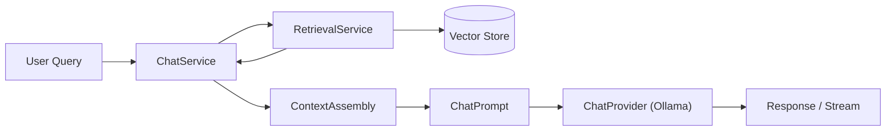
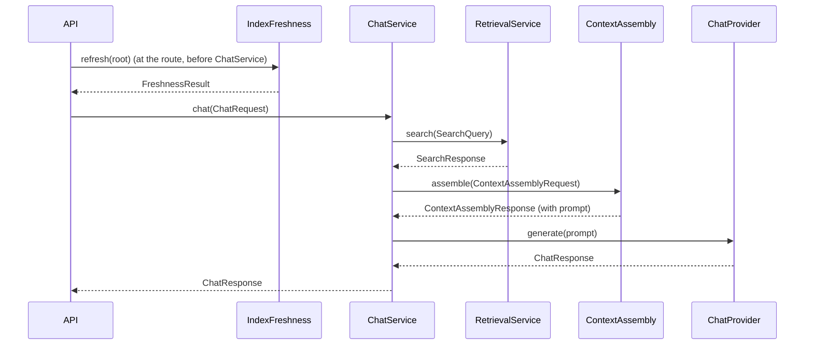

# Chat Subsystem

> **Status:** Complete
> **Sprint Introduced:** Sprint 6
> **Last Updated:** Sprint 14
> **Reading Time:** 4 minutes
> **Audience:** Backend contributors
> **Prerequisites:** [Retrieval](retrieval.md)
> **Related ADRs:** ADR-0012, ADR-0017
> **Related APIs:** `POST /chat`, `GET /chat/stream`
> **Next Reading:** [Editing](editing.md)

---

## Executive Summary

The Chat subsystem provides repository-aware conversational AI. It retrieves semantically relevant content from the indexed repository, assembles it into a prompt with retrieved context, and generates responses via a local LLM. Chat never indexes — it only retrieves.

---

## Responsibilities

- Query-based semantic retrieval (via `RetrievalService`)
- Context assembly (retrieved content → structured prompt)
- LLM interaction (text generation and streaming via `ChatProvider`)
- Conversation state management

---

## Ownership Boundaries

| Owned | Not Owned |
|-------|-----------|
| Conversational AI | Repository indexing |
| Context assembly integration | Embedding generation |
| Prompt construction | Vector storage |
| LLM interaction | Repository scanning |
| Streaming responses | Filesystem writes |
| — | Vector search (delegated to Retrieval) |

---

## Architecture



---

## Lifecycle: Chat Request



The freshness step belongs to the route, not to `ChatService`: `POST /chat` and `GET /chat/stream` first call `IndexFreshness.refresh` (ADR-0022), which updates the files changed since indexing for at most `RIP_INDEXING_REFRESH_SECONDS` and finishes the rest in a background thread. The result is returned with the answer (the `index` field of the `POST /chat` response), including a note when files could not be included. `ChatService` itself still never indexes.

`GET /chat/stream` sends named server-sent events before the answer's own events: `index-progress` (`{"files": n}`, when files changed, before the update starts), `index` (the `FreshnessResult`, except when the index is up to date, not built or incompatible), and `error` (`{"status", "detail"}`) when the chat fails after the stream has started and an HTTP status is no longer possible.

---

## Key Files

### ChatService

- **File:** `app/chat/service.py`
- **Dependencies:** `RetrievalService`, `ContextAssembly`, `ChatProvider`
- **Methods:**
  - `chat(request: ChatRequest) -> ChatResponse` — retrieve, assemble, generate
  - `stream(request: ChatRequest) -> Iterator[ChatChunk]` — streaming variant

### ContextAssembly (Interface)

- **File:** `app/context_assembly/providers.py`
- **Method:** `assemble(request: ContextAssemblyRequest) -> ContextAssemblyResponse`

### DefaultContextAssembly

- **File:** `app/context_assembly/service.py`
- Builds a `ChatPrompt` with system instruction + retrieved context + user query

### ChatPrompt

- **File:** `app/chat/models.py`
- Contains a list of `ChatMessage` objects (role + content)

### ChatProvider (Interface)

- **File:** `app/chat/providers.py`
- **Methods:** `generate(prompt) -> ChatResponse`, `stream(prompt) -> Iterator[ChatChunk]`

### OllamaChatProvider

- **File:** `app/chat/ollama_provider.py`
- Default implementation communicating with local Ollama instance
- Caps each answer at 4,096 tokens (`MAX_OUTPUT_TOKENS`, thinking included). Without the cap, a model caught in a repetition loop wrote one answer for over an hour and a half. An answer the cap cuts short ends with a note saying so.
- Streams under the hood, even for `generate()`, so the provider's `timeout_seconds` (default 120) means "Ollama sent nothing for that long", not "the answer took that long".

---

## Invariants

> [!IMPORTANT]

1. **Chat never indexes.** `ChatService` consumes retrieval results but never calls `IndexingService`.
2. **Chat never modifies files.** Repository modification belongs exclusively to the Editing subsystem.
3. **Prompt construction is owned by ContextAssembly**, not by ChatService.
4. **ChatProvider is an abstraction** — ChatService is not coupled to Ollama specifically.

---

## Extension Points

| Point | Mechanism | Example |
|-------|-----------|---------|
| Chat provider | Implement `ChatProvider` | Switch to a different LLM backend |
| Context assembly | Implement `ContextAssembly` | Custom prompt templates |
| Streaming | Uses `Iterator[ChatChunk]` | SSE events to frontend |

> [!TIP] To add a new LLM backend: implement `ChatProvider` and register it in `providers.py`. No chat service or context assembly changes are needed.

---

## Why This Design

Chat is intentionally decoupled from indexing. Project initialization indexes the project, and the route's freshness step (not `ChatService`) updates files changed since; `ChatService` itself never triggers indexing. This prevents accidental performance issues and keeps the architectural boundary clear.

Context assembly is a separate abstraction because prompt construction strategy may evolve independently of chat orchestration.

---

## Known Limitations

- No conversation history management beyond a single request-response cycle
- Context assembly uses a fixed prompt template — no customization exposed. It was chosen by measurement; see Measuring Answer Quality.

---

## Measuring Answer Quality

`python -m eval.answers` asks the search questions (`backend/eval/benchmarks.py`, and the held-out `backend/eval/holdout.py` with `--set holdout`) through the same chat service the app uses, with the configured chat model, and scores every answer:

- **Coverage:** the share of the question's expected files the answer cites, symbols it names and concepts it explains, averaged.
- **Invented names:** file paths, and names in code spans, that exist nowhere in the repository. Runtime files the code mentions (such as `.rip/project.json`) count as real. The scorer's own files count only for their paths and the names they define, since their examples are made up on purpose.
- **Refusals**, length and time per answer.

```powershell
cd backend
..\.venv\Scripts\python.exe -m eval.answers --root <path of an indexed copy of this repository> --json answers.json
```

Keyword coverage only stands in for a useful explanation, so read the answers in the JSON report too. The model answers differently every run: run each version at least twice, and count a change only if it beats the gap between two runs of the same version. Keep the JSON report outside the repository, or the next run will treat its invented names as real.

Index the copy right before measuring, and do not edit it during the runs. An index older than the code makes the model refuse, correctly, questions about code it was never shown, which looks like an over-cautious prompt: every held-out refusal in round 1 below came from an index one day older than the code.

**Round 1: prompt changes (2026-11-26, Sprint 14; `qwen3:8b`, thinking off).** These ran against an index built on 2026-11-25, older than some of the code the questions ask about. Every version used the same index, so the comparisons between versions hold; the absolute numbers do not (see round 2). The baseline answered tersely and cited few files. Each version was run twice on the 34 tuning questions:

| Version | Coverage | Answers inventing a name | Refusals | Words | Kept? |
|---|---|---|---|---|---|
| Baseline: rules-only instruction, 2,000-token context | 33.7% / 35.9% | 6% / 3% | 3% / 6% | ~150 | |
| Context raised to 4,000 tokens | 37.2% / 39.3% | 3% / 6% | 3% / 3% | ~150 | yes, with the next row |
| Instruction asks to explain the flow ("explain") | 44.7% / 42.7% | 3% / 6% | 0% / 0% | ~115 | |
| Both ("explain4k") | **46.1% / 46.5%** | 6% / 3% | 0% / 0% | ~114 | **in use** |
| Both, plus "cover every part, step by step" ("thorough4k") | 51.3% / 47.2% | 12% / 6% | 3% / 3% | ~190 | no: invented more, including vector stores RIP does not have |

The 4,000-token context only changes the prompt for the 6 questions whose retrieved code exceeds 2,000 tokens. On those 6, coverage rose from 34% to 47%; on the other 28 it moved within run-to-run noise. "explain" made 19 questions better and 7 worse, and left 8 unchanged. No answer reached the 4,096-token output cap.

Confirmed on the 15 held-out questions, never used for tuning:

| Version | Coverage | Answers inventing a name | Refusals |
|---|---|---|---|
| Baseline | 33.9% / 28.9% | 13% / 0% | 27% / 27% |
| explain4k | **42.2% / 43.9%** | **0% / 0%** | 27% / 27% |

explain4k grounds answers better rather than explaining more: file citations doubled (about 24% to 48% on the tuning set), but answers got shorter and concept coverage stayed level. "thorough4k" explained more but invented more. Its inventions were of three kinds: shortened real names (`Indexer` for `RepositoryIndexer`), "for example" implementations the code does not have (Pinecone, Weaviate), and real paths written as dotted modules (`app.indexing.service.py`).

**Round 2: a fresh index, and deeper answers (2026-11-27).** Measured against a copy of `main` at `72c8f06` indexed just before the runs (344 files, 1,337 chunks), so editing the code during the runs could not change what was measured. Two variants added one rule aimed at all three kinds of invention ("copy paths and names exactly as they appear in the context; give no examples the context does not show"): "exact4k" added it to explain4k, "thoroughexact4k" to thorough4k.

| Version (tuning, 34) | Coverage | Answers inventing a name | Refusals | Words | Seconds |
|---|---|---|---|---|---|
| explain4k (in use) | 52.3% / 50.3% | 3% / 6% | 0% / 0% | ~135 | 26 |
| exact4k | 53.0% / 50.5% | 3% / 3% | 0% / 0% | ~132 | 25 |
| thoroughexact4k | 54.3% / 55.3% | 6% / 3% | 0% / 0% | ~203 | 37 |

| Version (held out, 15) | Coverage | Answers inventing a name | Refusals | Words |
|---|---|---|---|---|
| explain4k (in use) | **66.7% / 61.7%** | 7% / 0% | 0% / 0% | ~148 |
| thoroughexact4k | 53.3% / 55.0% | 0% / 0% | 0% / 0% | ~227 |

- **The fresh index did more than any prompt.** With no prompt change, explain4k went from 46% to 51% on the tuning questions and from 43% to 64% held out, and held-out refusals fell from 27% to 0%. Three of the four questions refused in round 1 asked about code newer than the old index (the API token, the sign-in link, Ollama's `think` setting). The fourth expects `SignIn.tsx`, which search still misses; the model now answers from what search does find.
- **exact4k made no measurable difference** and is not used.
- **thoroughexact4k was rejected.** It was better on the tuning questions (16 better, 7 worse, 11 unchanged; about 50% longer answers) but worse held out (2 better, 6 worse, 7 unchanged). Its held-out answers name classes instead of files (`ChangeApplier` rather than `change_applier.py`), so file citations fell from 57-63% to 33-40%, while concept coverage rose only slightly (67-70% to 70-73%). A tuning gain that reverses on held-out questions is what the held-out set exists to catch.

What is left: deeper answers are still open. Two rounds of prompt wording have not produced them without a cost elsewhere, while a stale index cost more coverage than any wording gained.

**Round 3 (Sprint 15): a stale index with and without freshness (2026-11-28).** The same frozen snapshot of `main` at `72c8f06` and the same 15 held-out questions, answered with the app's own instruction and the 4,000-token context (explain4k's setting). The index was made stale for exactly the six files the four round-1 refusals need (`authStore.ts`, `SignIn.tsx`, `ollama_provider.py`, `llm/config.py`, `main.py`, `api_token.py`): they were indexed as of `7fb2b68` (2026-11-25), then the `72c8f06` versions were written back, leaving 7 files out of date (the six, plus the empty `.pre-commit-config.yaml`: at measurement time an empty file counted as changed on every check, a defect found during this measurement and fixed in commit 2c74c0e). The index was re-staled before every run. "Freshness off" calls `ChatService` directly, as the eval always did; "freshness on" first calls `IndexFreshness.refresh` before each question, as the routes do.

| Held out, 15 questions | Coverage | Files cited | Answers inventing a name | Refusals |
|---|---|---|---|---|
| Fresh index (round 2, explain4k) | 66.7% / 61.7% | 63% / 57% | 7% / 0% | 0% / 0% |
| Stale index, freshness off | 53.9% / 56.7% | 37% / 37% | 7% / 0% | 0% / 0% |
| Stale index, freshness on | 65.6% / 65.0% | 60% / 53% | 0% / 0% | 0% / 0% |

With freshness on, the first question of each run updated the 7 changed files in 7.5 s and 8.1 s; every later check took 0.2 to 0.7 s.

Conclusion: without freshness, a stale index cost 10 to 13 points of coverage (mostly files cited, 63% to 37%); with it, coverage matched the fresh index within the 5-point gap between the two fresh runs. The expected refusals did not return: this time the model answered from what search found instead of refusing, so the stale index showed up as answers that cite fewer of the right files, not as refusals. Run times in this round (41 to 114 s per answer) are not comparable with round 2's (about 27 s): the laptop was slower.

---

## Related Documents

| Document | Link |
|----------|------|
| Retrieval | [retrieval.md](retrieval.md) |
| Editing | [editing.md](editing.md) |
| Storage | [storage.md](storage.md) |
| System Overview | [../system-overview.md](../system-overview.md) |
| ADR-0012 | [../../adr/adr-0012-repository-aware-chat.md](../../adr/adr-0012-repository-aware-chat.md) |
| ADR-0017 | [../../adr/adr-0017-prompt-construction.md](../../adr/adr-0017-prompt-construction.md) |
