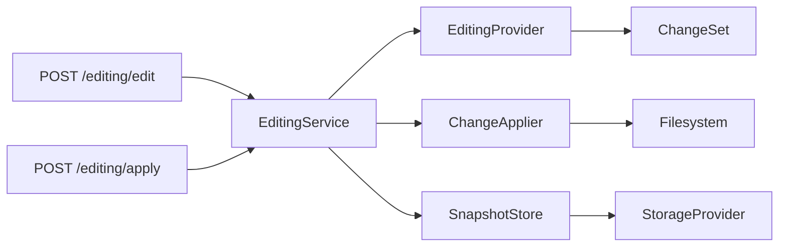
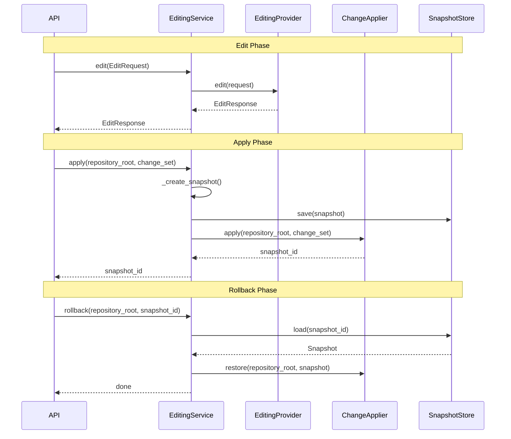

# Editing Subsystem

> **Status:** Complete
> **Sprint Introduced:** Sprint 8
> **Last Updated:** V1 M0 (editing safety)
> **Reading Time:** 4 minutes
> **Audience:** Backend contributors
> **Prerequisites:** [System Overview](../system-overview.md)
> **Related ADRs:** ADR-0010
> **Related APIs:** `POST /editing/edit`, `POST /editing/apply`, `POST /editing/rollback`
> **Next Reading:** [Storage](storage.md)

---

## Executive Summary

The Editing subsystem performs controlled source-code modifications. It generates patches via an AI provider, applies changes with automatic snapshot creation, and supports rollback to any previous state. Editing is the exclusive owner of repository modification — no other subsystem may write to the repository.

---

## Responsibilities

- Patch generation (via `EditingProvider`)
- Change application to repository files
- Snapshot creation before modification
- Snapshot persistence and rollback
- Diff preview

---

## Ownership Boundaries

| Owned | Not Owned |
|-------|-----------|
| Repository modification | Repository scanning |
| Snapshot creation | Metadata extraction |
| Change application | Semantic indexing |
| Rollback | Embedding generation |
| — | Vector search |

---

## Architecture

---

## Lifecycle: Edit → Apply → Rollback

---

## Key Files

### EditingService

- **File:** `app/editing/service.py`
- **Dependencies:** `EditingProvider`, `ChangeApplier`, `SnapshotStore`
- **Methods:**
  - `edit(request: EditRequest) -> EditResponse` — generate proposed changes
  - `apply(repository_root, change_set) -> snapshot_id` — apply + snapshot
  - `rollback(repository_root, snapshot_id) -> None` — restore snapshot

### EditingProvider (Interface)

- **File:** `app/editing/providers.py`
- **Method:** `edit(request: EditRequest) -> EditResponse`

### ChangeApplier

- **File:** `app/editing/change_applier.py`
- **Methods:**
  - `apply(repository_root, change_set)` — write changes to disk
  - `restore(repository_root, snapshot)` — revert files to snapshot state

### SnapshotStore

- **File:** `app/editing/snapshot_store.py`
- **Dependencies:** `StorageProvider`
- **Methods:** `save(snapshot)`, `load(snapshot_id) -> Snapshot`

---

## Invariants

> [!IMPORTANT]

1. **Editing is the sole owner of repository modification.** No other subsystem may write to the repository.
2. **All modifications are reversible.** Every `apply()` call creates a snapshot before making changes.
3. **Snapshot content is captured before modification.** If a file doesn't exist, snapshot stores empty content.
4. Editing never performs repository analysis — it only modifies.
5. **Only registered projects can be edited.** `EditingService` rejects any root without `.local_openclaw/project.json` (`UnregisteredRepositoryError`, HTTP 403). The caller chooses the root, so without this check "stay inside the repository root" would restrict nothing.
6. **Protected directories are never written.** `.git/` (writing `.git/hooks` is code execution) and `.local_openclaw/` (index and snapshots) are rejected at any depth, case-insensitively, and through symlinks. The list lives in `app/core/storage/locations.py` and is shared with the Workspace tools.
7. **Stale edits are refused.** Each `FileEdit.original_content` must equal the file's current content exactly (an empty string for a new file), or apply raises `EditConflictError` (HTTP 409).
8. **Rollback never overwrites later work.** Snapshots record `applied_sha256` per file. Rollback accepts each file only in a state the snapshot knows: what the apply wrote, or what was there before it (absent, for a created file). That makes the snapshot named by an incomplete revert usable. Anything else raises `EditConflictError`. Snapshots from before this field skip the check.
9. **Content is written byte for byte.** Reads and writes use `newline=""`, so line endings are never translated (the default would turn LF into CRLF on Windows).
10. **Paths are validated before any file is read.** `EditingService` validates every target (and, on rollback, every snapshot path) before snapshotting or checking anything, so a path outside the root is never even read. Empty change sets are rejected. Paths with NUL bytes, or `:` on Windows (alternate data streams), are rejected. Non-UTF-8 targets get a clear HTTP 400.
11. **Apply is all-or-nothing.** If a write fails, every file already written is restored from memory. If that restore also fails, `IncompleteRevertError` (HTTP 500) names the snapshot to roll back with; otherwise the unused snapshot is deleted.

---

## Extension Points

| Point | Mechanism | Example |
|-------|-----------|---------|
| Editing provider | Implement `EditingProvider` | Custom patch generation strategy |
| Snapshot storage | Modify `SnapshotStore` | Alternative snapshot backend |
| Change application | Modify `ChangeApplier` | Additional safety checks |

---

## Why This Design

The three-phase design (edit → review → apply) separates AI-generated changes from execution. Snapshots provide a safety net — every modification is reversible. The `EditingProvider` abstraction allows the patch generation strategy to evolve independently of the application and rollback mechanics.

---

## Known Limitations

- Snapshot IDs are returned to the caller but there's no endpoint to list snapshots.
- No snapshot cleanup strategy — snapshots accumulate indefinitely.
- `edit()` returns AI suggestions; the caller must explicitly call `apply()` to execute them.
- The default editing provider is a placeholder: `create file <path>` produces an empty file. LLM-backed edit planning arrives in V1 M4.
- Replacing a file through an atomic rename does not preserve its permission bits (for example, the executable bit on shell scripts).
- Rollback is not all-or-nothing: a write failure part-way through a restore leaves the remaining files unrestored.
- Paths are validated, then written later. A local process that swaps a parent directory for a junction in between could redirect a write. This needs a concurrent attacker who can already write to the repository.
- A `.local_openclaw` directory or `project.json` that is a symlink or junction is not treated as a registered project.

---

## Related Documents

| Document | Link |
|----------|------|
| Storage | [storage.md](storage.md) |
| System Overview | [../system-overview.md](../system-overview.md) |
| ADR-0010 | [../../adr/adr-0010-filesystem-persistence.md](../../adr/adr-0010-filesystem-persistence.md) |
| API Reference | [../../api/](../../api/) |
