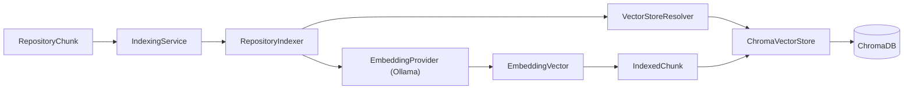
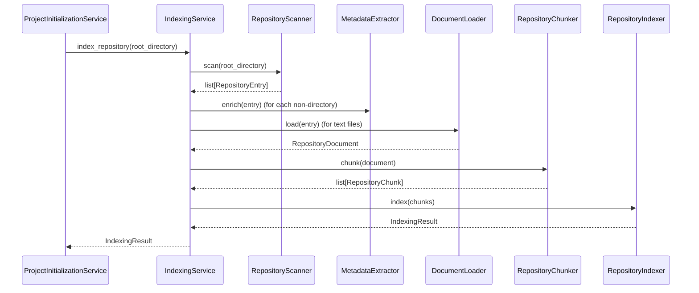

# Indexing Subsystem

> **Status:** Complete
> **Sprint Introduced:** Sprint 4
> **Last Updated:** Sprint 13
> **Reading Time:** 4 minutes
> **Audience:** Backend contributors
> **Prerequisites:** [Repository](repository.md)
> **Related ADRs:** ADR-0003, ADR-0016, ADR-0010
> **Related APIs:** `POST /projects/open` (triggers indexing)
> **Next Reading:** [Retrieval](retrieval.md)

---

## Executive Summary

The Indexing subsystem converts repository chunks into searchable semantic representations. It generates embeddings using a local model and persists them through a vector store. Indexing is triggered automatically during project open (via `ProjectInitializationService`) or can be run independently.

---

## Responsibilities

- Embedding generation via local models (`nomic-embed-text` through Ollama)
- `IndexedChunk` construction (chunk + embedding)
- Vector persistence coordination (delegated to `VectorStore`)
- Indexing result reporting

---

## Ownership Boundaries

| Owned | Not Owned |
|-------|-----------|
| Embedding generation | Repository scanning |
| Indexed chunk assembly | Metadata extraction |
| Indexing orchestration | Vector search |
| Indexing result reporting | Prompt construction |
| — | Repository modification |

---

## Architecture

---

## Lifecycle: Indexing Pipeline

---

## Freshness

`IndexFreshness` (`app/indexing/freshness.py`, ADR-0022) keeps the index in step with the files between full indexing runs. The chat routes, the semantic-search route, the edit-planning route (`POST /editing/proposals/plan`) and the MCP tool `search_semantic` call `refresh(root)` before they answer; `index_status` and `GET /workspace/index-status` call `status(root)`, which updates nothing.

- **Change detection.** Every file indexing would index (not a directory, indexable by name, text) is hashed with SHA-256 and compared with the hash stored in the index. The result is a `ChangeSet`: changed, added (not in the index) and removed (indexed but gone or no longer indexable). Hashes are cached per project in memory and reused while a file's mtime and size are unchanged, so a check with nothing changed hashes nothing. A file edited and then reverted counts as unchanged.
- **Updating.** `IndexingService.update_files(root, to_index, to_remove, deadline)` drops removed files from the index, then embeds the given files one at a time (most recently modified first), holding the inter-process index lock. No new file is started once the deadline passes; the rest is returned as `remaining`. A failing file keeps its existing chunks: it is `unindexable` when its own content is the cause (a decode or chunking error) and `failed` otherwise (a provider or OS error). The configured embedding model is read once the lock is held; if it changes, or no longer matches the index, no further file is written and the rest is returned as `remaining` with `model_changed`. The indexer also checks the model before and after embedding and stamps the index with the model it expected, so old vectors are never stamped as a new model.
- **Time limit and background thread.** `refresh` spends at most `RIP_INDEXING_REFRESH_SECONDS` (default 15) on `update_files`. Files left over are finished, with no limit, by one background thread per project root; while it runs, other `refresh` calls for that root report `partial` without touching the lock. After a model change no background thread is started, and the result is `incompatible`.
- **Files that cannot be indexed.** An `unindexable` file is remembered in the process with the hash detection saw, logged once, and left out of change detection until its content changes, so it is neither retried on every check nor reported as pending; `status` can reach `up_to_date` with it. Its previous chunks, if any, stay. A `failed` file is retried on the next `refresh`. Nothing is remembered across restarts: a new process tries such a file once more.
- **States** (`FreshnessResult.state`): `up_to_date` (nothing changed), `updated` (everything was updated before answering), `partial` (some files are not in the index yet: still updating, or failed), `busy` (another indexing run, in this process or another, holds the index lock), `updating` (this process is updating; `status` only), `stale` (files changed and nothing is updating them; `status` only), `off` (limit is `0`), `failed` (the update raised; logged), `not_indexed`, `incompatible`. `partial`, `busy`, `off` and `failed` carry a `note` saying how many files may be missing ("1 changed file", "N changed files"); the other states carry none.
- **What it never does.** It never rebuilds an index (an unindexed project, or one built with a different embedding model, is left alone: use `reindex`), never waits for the index lock, never raises (a failure becomes a `failed` result), never indexes a project nobody asked a question about, and never runs while RIP is idle: there is no file watcher.

---

## Key Files

### IndexingService

- **File:** `app/indexing/service.py`
- **Methods:**
  - `index_repository(root_directory: Path) -> IndexingResult` — scan, enrich, load, chunk, index
- Tracks: `scanned_files`, `indexed_files`, `indexed_chunks`, `skipped_files`, `failed_files`

### RepositoryIndexer

- **File:** `app/indexing/indexer.py`
- **Dependencies:** `EmbeddingProvider`, `VectorStoreResolver`
- **Methods:**
  - `index(chunks: Sequence[RepositoryChunk]) -> IndexingResult` — embed + store
- The vector store is resolved for the chunk's `root_directory` (`VectorStoreResolver.for_project(root, create=True)`), so persistence is project-root based — never process-CWD based.

### VectorStoreResolver

- **File:** `app/indexing/store_resolver.py`
- **Implementations:** `ProjectChromaStoreResolver` (per-project Chroma stores, `create=False` yields `None` for never-indexed projects), `StaticVectorStoreResolver` (test helper)
- **Key file:** `app/core/storage/locations.py` — canonical project storage layout (`<root>/.rip/`, `index/chroma/`, `snapshots/`, `project.json`)

### IndexingResult

- **File:** `app/indexing/models.py`
- Fields: `scanned_files`, `indexed_files`, `indexed_chunks`, `skipped_files`, `failed_files`, `unchanged_files`
- `scanned_files = indexed_files + skipped_files + failed_files`; `unchanged_files` is part of `indexed_files`. Each field carries this description in the API and MCP schemas.

---

## Invariants

> [!IMPORTANT]

1. Indexing **never performs retrieval**. The retrieval subsystem is a separate consumer of the vector store.
2. Indexing **never owns vector persistence logic**. Persistence is delegated to `VectorStore`, resolved through `VectorStoreResolver`.
3. **Persistence identity comes from the opened project, not the process CWD.** Chroma persistence always resolves to `<project root>/.rip/index/chroma` for the indexed project.
4. `IndexingResult` is the sole output contract — callers receive summary counts.
5. Indexing skips directories and non-text files silently.
6. **Indexing respects the repository's git ignore rules.** `RepositoryIgnoreRules` (`app/repository/ignore.py`) applies every `.gitignore` (deeper files take precedence, `!` re-includes work) and `.git/info/exclude`, on top of the names RIP always skips. Ignored directories are never entered. A file ignored after it was indexed is removed on the next run. Committed dependency lock files (`uv.lock`, `package-lock.json`, `yarn.lock`, `Cargo.lock` and similar, see `NOT_INDEXED_FILE_NAMES`) are also left out of the index, but stay listable and searchable in the workspace tools.
7. **Unchanged content is never re-embedded.** Before embedding, the indexer fetches the chunk ids already stored for the project; chunks whose ids exist keep their vectors, and every current id is kept when stale chunks are removed. A rebuild for a new embedding model ignores the existing ids.
8. **Every index records the embedding model that built it.** `RepositoryIndexer` stamps the Chroma collection metadata with the provider's `identity` (for example `ollama:nomic-embed-text`) and the vector dimension. The stamp lives in the collection itself, so `clear()` removes it together with the vectors.
9. **Embedding models are never mixed.** `RepositoryIndexer.prepare()` marks an index that was built by a different model, or before the model was recorded, for rebuilding. The clear happens only after the first batch has been embedded successfully, so if the provider is down or the new model is missing, the old index survives. Chunk ids do not include the model, and Chroma's `add` keeps the existing vector for an existing id, so without the clear, unchanged chunks would keep stale vectors. Only an explicit indexing run does this; changing the configured model never reindexes on its own.

---

## Extension Points

| Point | Mechanism | Example |
|-------|-----------|---------|
| Embedding provider | Implement `EmbeddingProvider` | Switch to a different local model |
| Vector store | Implement `VectorStore` | Use PostgreSQL + pgvector |
| Indexing pipeline | Modify `IndexingService.index_repository()` | Add pre/post processing steps |

> [!TIP] To add a new embedding model: implement `EmbeddingProvider` and update the provider function in `app/dependencies/providers.py`. No other subsystem changes are needed.

---

## Why This Design

Embedding generation and vector persistence are separated through `EmbeddingProvider` and `VectorStore` interfaces. This allows each to evolve independently. The `RepositoryIndexer` coordinates the two without being coupled to any specific implementation.

Indexing is independent of retrieval by design — `RetrievalService` never indexes, and `IndexingService` never searches. This prevents circular dependencies and keeps each subsystem testable in isolation.

---

## Known Limitations

- Indexing processes all text files synchronously. For very large repositories this can be slow.
- Python files are chunked by their top-level definitions. A function or class chunk starts at its first decorator (a route's URL lives there), and consecutive top-level statements (docstring, imports, constants) form one module chunk of at most 100 lines, so single import lines never fill search results. Other languages use 100-line chunks. Changing these boundaries changes chunk ids, so the first reindex after such a change re-embeds the affected files once.
- Every run still scans, hashes and chunks every file (cheap), but only embeds chunks not already in the index (the expensive part). Chunk ids include the file's content hash, so unchanged files are recognized without any extra bookkeeping; `IndexingResult.unchanged_files` reports them, and `indexed_chunks` counts only newly embedded chunks.
- Indexing holds an inter-process OS file lock (`.rip/index/index.lock`), so the RIP app and an MCP server never write one index at once; a second indexer gets `IndexingBusyError` (HTTP 409).
- ChromaDB is created with anonymized telemetry disabled (offline-first, ADR-0001).
- When every file fails to index (typically the embedding provider is down), stale-chunk removal is skipped, so the existing index is kept instead of being emptied. A single file that fails temporarily (locked, briefly unreadable) keeps its existing chunks too.
- Ignore files are repository content, so they are read defensively: symlinked ones and files over 1 MB are skipped, as are patterns with more than three `*` in one path segment, which would make matching exponentially slow.
- Only the repository's own git ignore files are honored (`.gitignore` files and `.git/info/exclude`); a global `core.excludesFile` is not read.

---

## Related Documents

| Document | Link |
|----------|------|
| Repository | [repository.md](repository.md) |
| Retrieval | [retrieval.md](retrieval.md) |
| Storage | [storage.md](storage.md) |
| Project Management | [project-management.md](project-management.md) |
| ADR-0003 | [../../adr/adr-0003-indexing-ownership.md](../../adr/adr-0003-indexing-ownership.md) |
| ADR-0016 | [../../adr/adr-0016-embedding-model-selection.md](../../adr/adr-0016-embedding-model-selection.md) |
