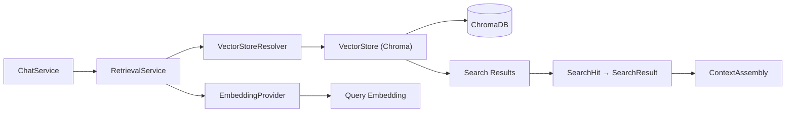
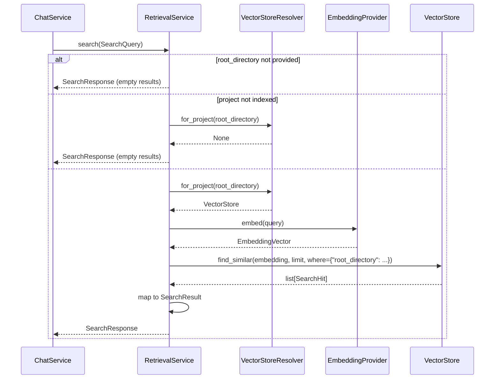

# Retrieval Subsystem

> **Status:** Complete
> **Sprint Introduced:** Sprint 5
> **Last Updated:** Sprint 13
> **Reading Time:** 4 minutes
> **Audience:** Backend contributors
> **Prerequisites:** [Indexing](indexing.md)
> **Related ADRs:** ADR-0004, ADR-0008, ADR-0010
> **Related APIs:** `POST /chat` (uses retrieval internally)
> **Next Reading:** [Chat](chat.md)

---

## Executive Summary

The Retrieval subsystem performs semantic search over indexed repository content. It generates query embeddings and searches the vector store, returning ranked results. Retrieval is consumed by `ChatService` to provide repository-aware context — but retrieval itself remains independent of chat, indexing, and prompt construction.

---

## Responsibilities

- Query embedding generation (via `EmbeddingProvider`)
- Vector search orchestration (via `VectorStore`)
- Search result mapping to retrieval projections

---

## Ownership Boundaries

| Owned | Not Owned |
|-------|-----------|
| Query embedding | Indexing new content |
| Vector search | Vector persistence (delegated to VectorStore) |
| Search result transformation | Prompt construction |
| Retrieval projection models | Conversation state |
| — | Repository scanning |

---

## Architecture



---

## Lifecycle: Semantic Search



---

## Key Files

### RetrievalService

- **File:** `app/indexing/retrieval_service.py`
- **Dependencies:** `EmbeddingProvider`, `VectorStoreResolver`
- **Methods:**
  - `search(query: SearchQuery) -> SearchResponse` — embed query, search the project-scoped vector store, return results
- Retrieval is project-scoped: the store is resolved from `query.root_directory`. Searches without a root directory, or for projects that have never been indexed, return empty results (no cross-project leakage).

### SearchQuery

- **File:** `app/indexing/retrieval_models.py`
- Fields: `query: str`, `root_directory: str | None` (default None), `limit: int` (default 10)

### SearchHit

- Raw result from vector store. Contains `chunk_id`, `content`, `metadata`, `boundary`, `vector_score`.

### SearchResult

- Transformed result for API consumers. Contains `chunk_id`, `content`, `metadata`, `boundary`, `similarity_score`.

### SearchResponse

- API response. Contains `query: str` and `results: list[SearchResult]`.

---

## Invariants

> [!IMPORTANT]

1. **Retrieval never indexes.** It never writes to the vector store — only reads.
2. **Retrieval never owns vector persistence.** `VectorStore`, resolved through `VectorStoreResolver`, owns persistence.
3. **Retrieval is project-scoped.** A query without a `root_directory`, or for a project that has never been indexed, returns no results.
4. `SearchHit` is a **projection**, independent of `IndexedChunk`. Changes to indexing models do not require changes to retrieval models.
5. Retrieval does not assemble prompts or interact with chat state.

---

## Extension Points

| Point | Mechanism | Example |
|-------|-----------|---------|
| Search strategy | Modify `RetrievalService.search()` | Add hybrid search (vector + keyword) |
| Result ranking | Modify result mapping | Custom scoring or filtering |
| Query transformation | Pre-process query before embedding | Query expansion |

> [!TIP] Retrieval is stateless. It can be called independently of chat for any application that needs semantic repository search.

---

## Why This Design

Retrieval is separated from indexing to prevent circular dependencies and to allow each to evolve independently. The `SearchHit` → `SearchResult` mapping provides a stable API projection that isolates consumers from internal vector store representation.

---

## Known Limitations

- Vector similarity with two measured ranking adjustments (test files ×0.92, one result per file). No hybrid or keyword search.
- No filtering by file path, language, or date.
- No pagination beyond the `limit` parameter.
- Unscoped queries (no `root_directory`) return no results by design — search requires an opened, indexed project.

---

## Measuring Search Quality

`backend/eval/benchmarks.py` holds 34 questions about this repository, each with the files a good answer needs. Run them against a real index:

```powershell
cd backend
..\.venv\Scripts\python.exe -m eval --root <path of an indexed copy of this repository> --json report.json
```

It prints, per question, the rank of the first right file, and overall: **hit@1** (right file first), **hit@3**, **hit@10**, **MRR** (mean of 1/rank) and recall. Measure before and after any change to chunking, embedding or ranking.

**Baseline** (2026-11-26; `nomic-embed-text`, top 10 chunks, 336 files, 1,284 chunks):

| hit@1 | hit@3 | hit@10 | MRR | recall |
|---|---|---|---|---|
| 18% | 50% | 79% | 0.38 | 62% |

**Ranking changes (2026-11-26).** `backend/eval/holdout.py` holds 15 more questions, written before any tuning and never used for it (`--set holdout`). A ranking idea was kept only if it improved the tuning set without hurting the held-out set. Each idea was tried at several strengths on the same top-50 candidates per question:

| Idea | Tuning MRR | Held-out MRR | Kept? |
|---|---|---|---|
| (baseline) | 0.38 | 0.40 | |
| Test files score ×0.92 (×0.90-0.94 identical) | 0.48 | 0.48 | yes |
| Each file once, with its best chunk | 0.39 | 0.43 | yes |
| Both together | **0.49** | **0.50** | **in use** |
| Chunks under 80-250 characters score ×0.94-0.97 | up to 0.43 | down to 0.37 | no: helped tuning, hurt held-out hit@1 (33% to 27%) |

Result with both changes, measured end to end:

| Set | hit@1 | hit@3 | hit@10 | MRR | recall |
|---|---|---|---|---|---|
| Tuning (34) | 18% → **32%** | 50% → **56%** | 79% → **88%** | 0.38 → **0.49** | 62% → **74%** |
| Held-out (15) | 33% → **40%** | 40% → **53%** | 73% → **87%** | 0.40 → **0.50** | 60% → **80%** |

No question got worse: 18 better and 16 unchanged on the tuning set, 7 better and 8 unchanged held out. The search asks the store for at least 50 candidates and ranks them, so each file still appears at most once in a full set of results.

What held the baseline back, from the per-question results:
- Several chunks of one file fill the results (2.6 of 10 on average), so fewer distinct files fit.
- Test files describe the same behavior in the same words: 30% of retrieved chunks are tests, and they rank above the right source file 39 times.
- Docstring-only `__init__.py` modules (`"""Indexing subsystem."""`) win "which subsystem owns X" questions.
- Some expectations are narrow: ownership questions also have good answers in the ADRs, which the benchmarks do not accept. `eval/benchmarks.py` itself appears in results, since it contains the questions. (Left unchanged on purpose: changing the questions would move the yardstick, not the search.)

---

## Related Documents

| Document | Link |
|----------|------|
| Indexing | [indexing.md](indexing.md) |
| Chat | [chat.md](chat.md) |
| Storage | [storage.md](storage.md) |
| System Overview | [../system-overview.md](../system-overview.md) |
| ADR-0004 | [../../adr/adr-0004-retrieval-boundaries.md](../../adr/adr-0004-retrieval-boundaries.md) |
| ADR-0008 | [../../adr/adr-0008-search-projection.md](../../adr/adr-0008-search-projection.md) |
